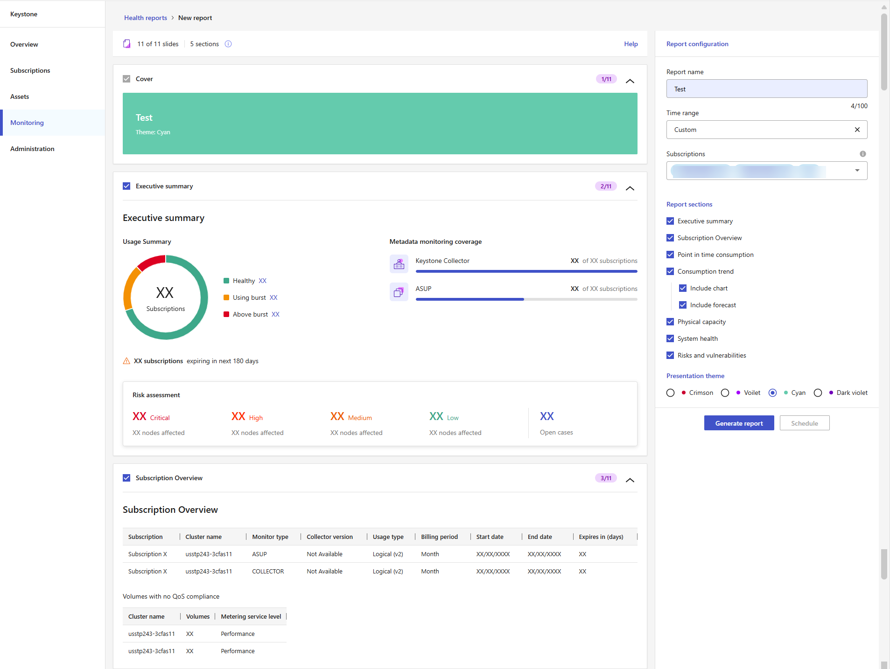

= Genera e pianifica report sullo stato di salute per gli abbonamenti Keystone
:hardbreaks:
:allow-uri-read: 
:nofooter: 
:icons: font
:linkattrs: 
:imagesdir: ../media/

[role="lead"]
Genera o pianifica report sullo stato di salute per una o più sottoscrizioni Keystone dalla dashboard Keystone in NetApp Console. Questi report forniscono una vista consolidata dell'utilizzo delle sottoscrizioni, dello stato operativo, dei rischi e delle vulnerabilità che puoi condividere con i destinatari previsti. Questa funzionalità non è disponibile in Digital Advisor.

.A proposito di questa attività
I report sullo stato di salute offrono una panoramica sull'utilizzo degli abbonamenti, sullo stato operativo e sui rischi identificati per gli abbonamenti selezionati. Nella pagina *Nuovo report*, usa il pannello *Configurazione report* per definire l'ambito e le opzioni del report. Usa l'area di anteprima per visualizzare l'ordine e il layout delle diapositive prima di generare o pianificare il report. L'anteprima mostra solo la struttura del report e non visualizza i dati effettivi degli abbonamenti.

Segui questi passaggi per generare un report da scaricare immediatamente oppure per programmare un report una tantum o ricorrente da ricevere in un secondo momento:

.Fasi
. Dal menu di navigazione a sinistra della Console, seleziona *Archiviazione > Keystone > Monitoraggio > Report*.
. Seleziona *New report*.
. Nel pannello *Configurazione report*, immetti un nome nel campo *Nome report*.
. Seleziona un intervallo di tempo dal menu a tendina *Intervallo di tempo*.
+
Seleziona un intervallo predefinito, ad esempio *Ultimi 60 giorni*, oppure seleziona *Personalizzato* per inserire le tue date. L'intervallo selezionato determina i dati storici visualizzati nella sezione *Andamento dei consumi* e in altre sezioni basate sul tempo. Se selezioni *Personalizzato*, non puoi pianificare il report.

+

. Seleziona uno o più abbonamenti dal menu a tendina *Subscriptions*.
+

NOTE: I partner NetApp possono selezionare abbonamenti in uno o più account cliente Keystone gestiti.

. In *Sezioni del report*, seleziona le sezioni che vuoi includere.
+
Ogni sezione che selezioni appare nell'area di anteprima ed è inclusa nel report generato. Ad esempio, puoi includere un riepilogo delle tue sottoscrizioni, l'utilizzo attuale della capacità, le tendenze di consumo, la capacità fisica, lo stato di salute del sistema, i rischi e le vulnerabilità. Per *Tendenza di consumo*, puoi includere un grafico del consumo storico e, facoltativamente, una previsione del consumo futuro.

. Seleziona un tema di presentazione.
. Esamina le sezioni visualizzate nell'area di anteprima per verificare che corrispondano alle tue selezioni.
. Scegli come vuoi creare il report.
+
** *Genera report*
+
Seleziona *Genera report* per scaricare immediatamente il report.

+
Il report viene inviato per la generazione e vieni reindirizzato alla scheda *Reports*. Il report appare con lo stato *Running*.

+
Dopo che lo stato cambia in *Generato*, seleziona l'icona con i tre puntini alla fine della riga del report e poi seleziona *Scarica*.

** *Pianifica report*
+
Seleziona *Pianifica* per creare un report una tantum o ricorrente e completa i seguenti passaggi:

+
... Seleziona una frequenza: *Una sola volta*, *Settimanale*, *Mensile* o *Trimestrale*.
... Seleziona una *data di inizio*.
+
image:../media/schedule-dialog.png["Finestra di dialogo del report di pianificazione che mostra la frequenza settimanale selezionata, i campi data di inizio e data di fine vuoti, un campo Destinatari e il formato PPT selezionato"]

+
La data di inizio determina quando il report viene eseguito per la prima volta. Per le frequenze ricorrenti, il report viene eseguito di nuovo in base alla pianificazione settimanale, mensile o trimestrale selezionata.

... Se vuoi, seleziona una *data di fine*.
+
Se non selezioni una data di fine, la pianificazione continua finché non la modifichi.

... Seleziona *Pianifica report*.
+
La pianificazione viene creata e il report appare nella scheda *Reports* con un tipo di esecuzione *Scheduled run*. Usa le colonne *Last run*, *Next run* e *Status* per tenere traccia di ogni esecuzione.

+
Per modificare una pianificazione settimanale, mensile o trimestrale, seleziona l'icona con i tre puntini alla fine della riga del report, quindi seleziona *Modifica pianificazione*. Puoi farlo sia che lo stato sia *Pianificato* sia che sia *Generato*. Non puoi modificare una pianificazione *Una tantum* dopo che il report è stato generato.

+
Dopo che lo stato cambia in *Generato*, seleziona l'icona con i tre puntini accanto al report e seleziona *Scarica*.

.Risultato
I report generati vengono scaricati come presentazioni PowerPoint. Puoi selezionare *Genera di nuovo* dal menu con i tre puntini per creare un nuovo report con la stessa configurazione.

*Informazioni correlate*

* link:../integrations/dashboard-access.html["Inizia con la dashboard Keystone"]
* link:../integrations/subscriptions-tab.html["Visualizza i dettagli sui tuoi abbonamenti Keystone"]
* link:../integrations/current-usage-tab.html["Visualizza l'utilizzo attuale"]
* link:../integrations/consumption-tab.html["Visualizza le tendenze di consumo"]
* link:../integrations/assets-tab.html["Visualizza le risorse associate ai tuoi abbonamenti"]
* link:../integrations/monitoring-alerts.html["Visualizza e gestisci gli avvisi"]
* link:../integrations/monitoring-alert-monitors.html["Visualizza e crea monitor di avviso"]

